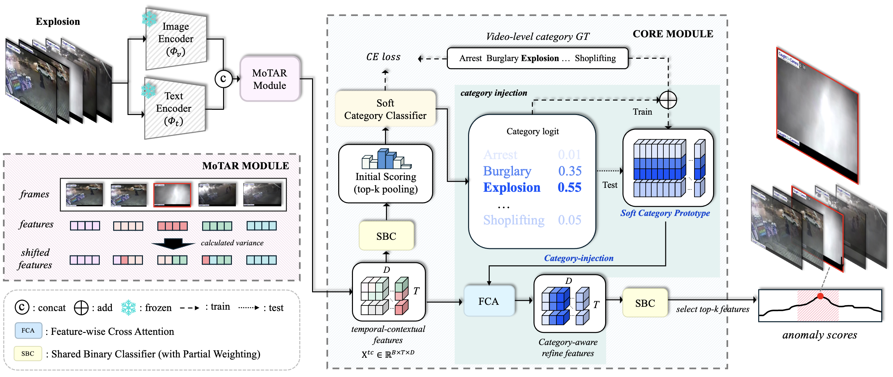

# RefineVAD: Semantic-Guided Feature Recalibration for Weakly Supervised Video Anomaly Detection [AAAI'26]

**Official Repository for the AAAI 2026 paper "RefineVAD"**

This repository hosts the official implementation of:

**RefineVAD: Semantic-Guided Feature Recalibration for Weakly Supervised Video Anomaly Detection**

## Authors
JunHee Lee*, ChaeBeen Bang*, MyoungChul Kim*, MyeongAh Cho†  
*Equal Contribution †Corresponding Author

---

## Main Figure

Place your main figure inside the `assets/` directory as:

```
assets/main_fig.png
```

Then referenced in this README as:



---

## Status

The source code, pretrained models, and additional materials will be released soon.  
**Updates will follow.**

---
